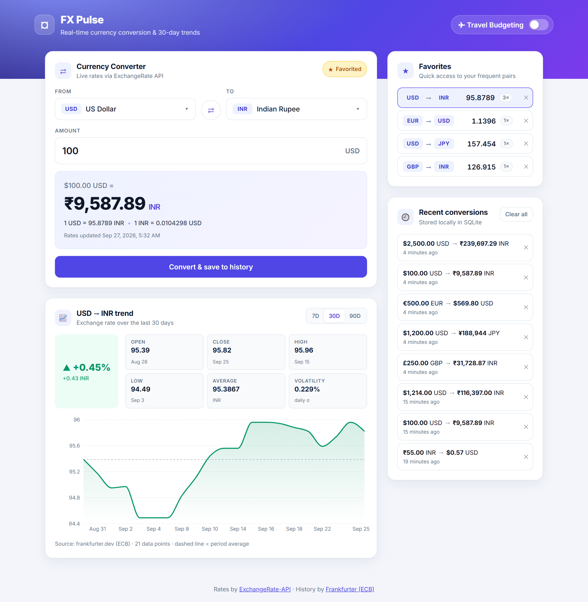
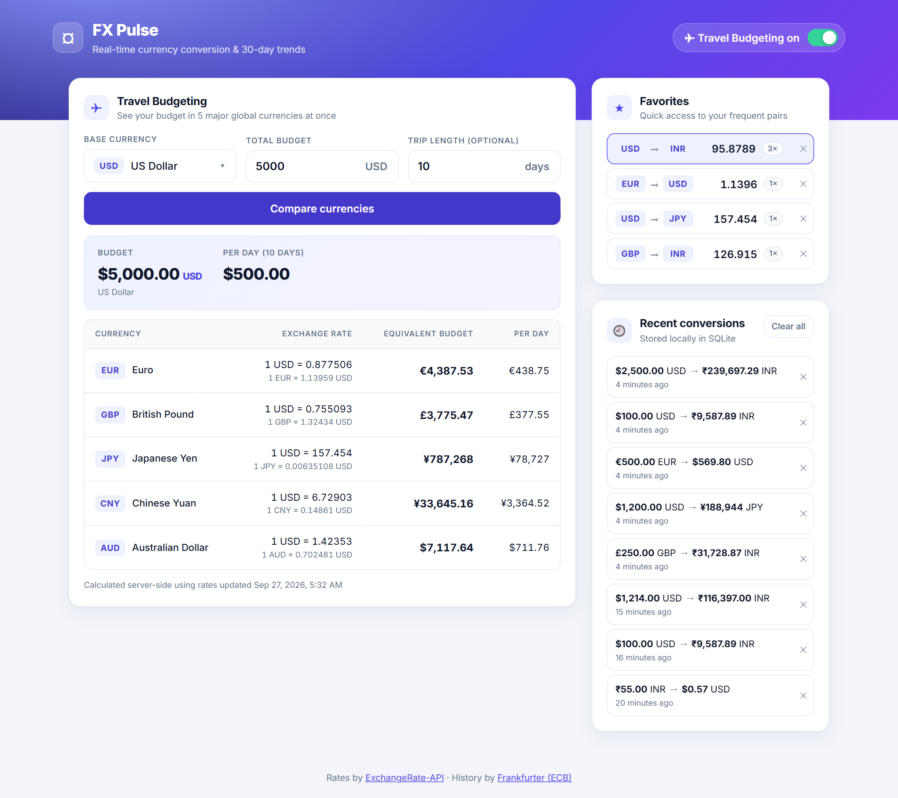
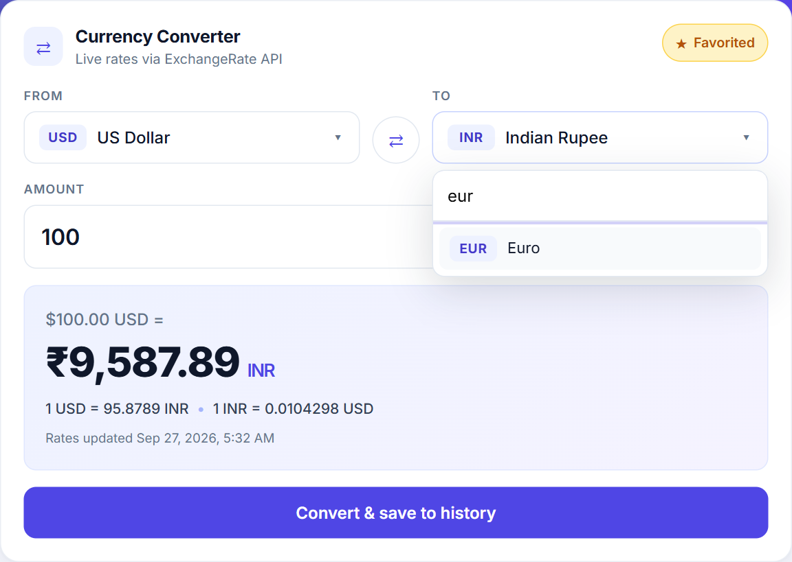
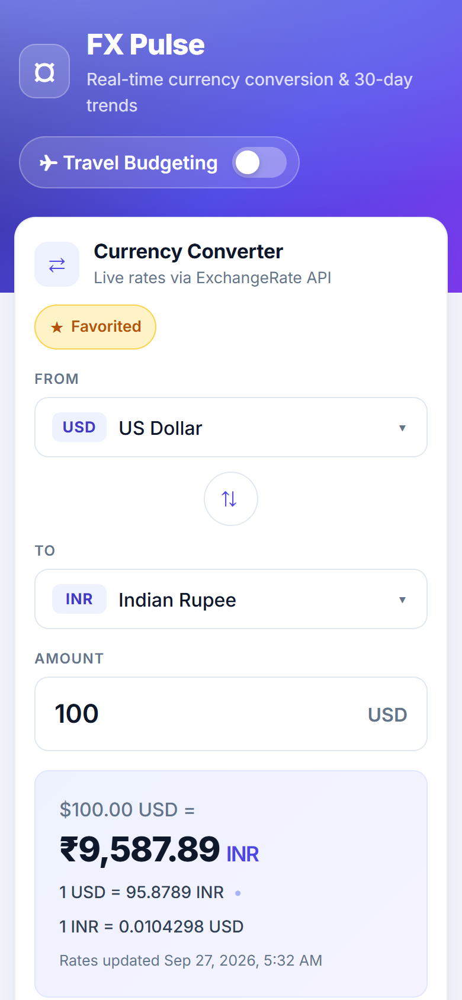

# FX Pulse — Currency Converter

A clean, fast utility for real-time currency conversion with historical trend visualization, favorites, locally cached history and a **Travel Budgeting** mode.


- **Frontend:** React 19 + Vite, Recharts
- **Backend:** Node.js + Express 5, Zod validation
- **Persistence:** SQLite (`better-sqlite3`)
- **Rates:** [ExchangeRate-API](https://www.exchangerate-api.com) (live), [Frankfurter](https://frankfurter.dev) (ECB time-series for trends)

## Screenshots

### Converter, 30-day trend, favorites & history



### Travel Budgeting mode

Budget converted server-side into 5 major global currencies, with a per-day split.



### Searchable currency selector & mobile layout

<p>
  
  &nbsp;
  
</p>

## Features

| Requirement | Implementation |
| --- | --- |
| Dual converter | Side-by-side searchable **From / To** currency selectors, swap button and amount input. Live quote while typing; **Convert & save** records the conversion. |
| Trend chart | Area chart of the exchange rate for the selected pair over the **last 30 days** (7D / 90D also available) with server-computed open/close/high/low/average, % change and volatility. |
| Favorites | Pin frequently used pairs (★). The list shows each pair's current rate, is ordered by how often you use it, and one click loads the pair into the converter. |
| Exchange rates | Fetched from ExchangeRate-API. Uses the authenticated v6 endpoint when `EXCHANGE_RATE_API_KEY` is set, otherwise the free open-access endpoint. |
| Local persistence | SQLite stores conversion history, favorites, a rate cache (TTL) and daily rate snapshots. |
| **Travel Budgeting** (vibe check) | Toggle in the header. Enter a base currency + amount (and optional trip length); the **backend** calculates the equivalent in 5 major global currencies (USD, EUR, GBP, JPY, CNY — base currency is skipped and AUD fills in) and returns a comparison table, including per-day budget. |

## Quick start

Prerequisites: **Node.js 18.18+** (tested on Node 22) and npm.

```bash
git clone https://github.com/Jyothinaradam08/Quantiphi_Currency_Converter.git
cd Quantiphi_Currency_Converter

npm run install:all                 # installs root, backend and frontend deps
cp backend/.env.example backend/.env   # Windows: copy backend\.env.example backend\.env
npm run dev                         # starts API (http://localhost:5000) + web (http://localhost:5173)
```

Open **http://localhost:5173**.

Other scripts (from the root):

| Script | What it does |
| --- | --- |
| `npm test` | Runs backend API tests (in-memory SQLite, mocked providers, no network) |
| `npm run build` | Production build of the frontend into `frontend/dist` |
| `npm start` | Starts the backend without file watching |

### Configuration (`backend/.env`)

| Variable | Default | Purpose |
| --- | --- | --- |
| `PORT` | `5000` | API port |
| `CORS_ORIGIN` | `http://localhost:5173` | Allowed frontend origins (comma separated) |
| `DB_PATH` | `./data/currency.db` | SQLite file (created automatically) |
| `EXCHANGE_RATE_API_KEY` | _(empty)_ | Optional ExchangeRate-API key; empty → open-access endpoint |
| `LATEST_RATES_TTL_MINUTES` | `60` | How long cached live rates are reused |
| `TREND_TTL_MINUTES` | `360` | How long cached trend series are reused |
| `HISTORY_MAX_ROWS` | `100` | Conversion history retention |

## Architecture

```
Quantiphi_Currency_Converter/
├── docs/screenshots/            # UI reference images used in this README
├── backend/
│   ├── src/
│   │   ├── server.js            # bootstrap + graceful shutdown
│   │   ├── app.js               # express app: security, CORS, rate limit, routes, errors
│   │   ├── container.js         # composition root (dependency injection)
│   │   ├── config/              # env-driven configuration
│   │   ├── db/                  # SQLite connection + schema
│   │   ├── providers/           # external API adapters (ExchangeRate-API, Frankfurter)
│   │   ├── repositories/        # all SQL lives here
│   │   ├── services/            # business logic & calculations
│   │   ├── controllers/         # thin HTTP handlers
│   │   ├── routes/              # route table
│   │   ├── validators/          # Zod request schemas
│   │   ├── middleware/          # validation + error handling
│   │   └── utils/               # AppError, money rounding/formatting, http client
│   └── tests/                   # node:test + supertest
└── frontend/
    └── src/
        ├── api/                 # HTTP client + endpoint functions
        ├── hooks/               # data/state hooks (converter, trend, favorites, history)
        ├── components/
        │   ├── common/          # Card, CurrencySelect, AmountInput, Toggle, Alert, Spinner
        │   ├── layout/          # Header
        │   ├── converter/       # ConverterPanel, ConversionResult
        │   ├── trend/           # TrendChart, TrendStats
        │   ├── favorites/       # FavoritesPanel
        │   ├── history/         # HistoryPanel
        │   └── travel/          # TravelBudgetPanel, ComparisonTable
        ├── utils/format.js      # display-only date/rate formatting
        └── styles/index.css     # design tokens + component styles
```

**Request flow:** `route → validate (Zod) → controller → service → repository / provider`.

### Server-side responsibility

All business logic lives in the backend; the React app only renders data and captures input:

- Input validation and normalisation (ISO 4217 codes, positive finite amounts, limits, trip length).
- Currency support checks, cross-rate calculation, per-currency rounding (e.g. JPY has 0 decimals) and locale-formatted money strings.
- Trend statistics (open/close/high/low/average, change %, direction, daily volatility).
- Travel Budgeting target selection, conversions and per-day split.
- Favorite ordering by usage (usage is bumped automatically when a conversion of that pair is saved), duplicate prevention and limits.
- History retention/pruning.

### Caching & resilience

- **Live rates** are cached per base currency in SQLite (`rate_cache`) with a TTL; concurrent requests share one in-flight fetch. If the provider is unavailable, the last cached rates are served and flagged `stale: true` (shown in the UI).
- **Trends** are cached in `trend_cache`. Frankfurter covers ~30 major currencies; for other pairs the API falls back to **daily snapshots** that the backend records in `rate_snapshots` every time live rates are fetched, so history accumulates over time.

### SQLite schema

| Table | Purpose |
| --- | --- |
| `conversions` | Recent conversion history (pruned to `HISTORY_MAX_ROWS`) |
| `favorites` | User favorite pairs with `usage_count` / `last_used_at` (unique per pair) |
| `rate_cache` | Latest rates per base currency + fetch timestamp |
| `rate_snapshots` | One rate table per base currency per day (60-day retention) |
| `trend_cache` | Cached trend payloads per pair and range |

## API reference

Base URL: `http://localhost:5000/api`. Errors use `{ "error": { "code", "message", "details?" } }`.

| Method | Endpoint | Description |
| --- | --- | --- |
| GET | `/health` | Health check |
| GET | `/currencies` | Supported currencies `[{ code, name }]` |
| GET | `/rates/convert?from=USD&to=EUR&amount=100` | Live quote (not persisted) |
| POST | `/conversions` `{ from, to, amount }` | Convert and save to history |
| GET | `/conversions?limit=10` | Recent history |
| DELETE | `/conversions/:id` | Delete one history entry |
| DELETE | `/conversions` | Clear history |
| GET | `/trends?from=USD&to=INR&days=30` | Rate series + statistics (`days` 7–90, default 30) |
| GET | `/favorites` | Favorites with current rates |
| POST | `/favorites` `{ from, to }` | Add favorite (409 if duplicate) |
| DELETE | `/favorites/:id` | Remove favorite |
| POST | `/travel-budget` `{ baseCurrency, amount, tripDays? }` | Travel Budgeting comparison across 5 major currencies |

Example:

```bash
curl -X POST http://localhost:5000/api/travel-budget \
  -H "Content-Type: application/json" \
  -d '{"baseCurrency":"INR","amount":100000,"tripDays":7}'
```
